# SOOP 모아

공식 SOOP 임베드 플레이어와 Open API를 활용해, SOOP 라이브 방송 여러 개를 한 화면에서 동시에 보는 멀티뷰와 시청자들이 자유롭게 소통하는 커뮤니티를 제공하는 플랫폼입니다.

**[soopmoa.vercel.app](https://soopmoa.vercel.app)** · [사용 가이드](https://soopmoa.vercel.app/guide)

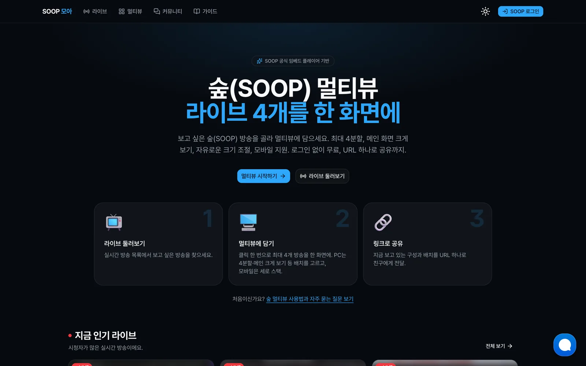

## 왜 만들었나

안녕하세요! 👋 프론트엔드 개발자 엄성준입니다.

저는 아프리카TV 시절부터 SOOP을 꾸준히 이용해 왔습니다.

평소 SOOP에 관심이 많아 Open API를 살펴보던 중, 이를 활용해 직접 무언가 만들어 보고 싶다는 생각이 들었습니다. 그러다 여러 방송을 한 번에 볼 수 있으면 좋겠다는 아이디어가 떠올라 SOOP 모아를 개발하게 되었습니다.

현재는 멀티뷰를 중심으로 운영하고 있으며, 앞으로는 AI를 활용한 기능과 시청자에게 유용한 데이터·정보를 함께 제공하는 방향으로 발전시켜 나갈 계획입니다.

## 화면으로 보는 기능

스크린샷 속 방송 화면과 썸네일은 스트리머 초상권을 지키려고 흐리게 처리했습니다.

### 멀티뷰

라이브 방송을 최대 4개까지 한 화면에서 동시에 봅니다.

왼쪽 목록에서 방송을 누르면 빈 칸부터 채워지고, 목록에 없는 방송은 BJ 아이디나 방송 주소를 붙여 넣어 추가합니다. 패널 사이 경계선을 드래그하면 크기가 바뀝니다.

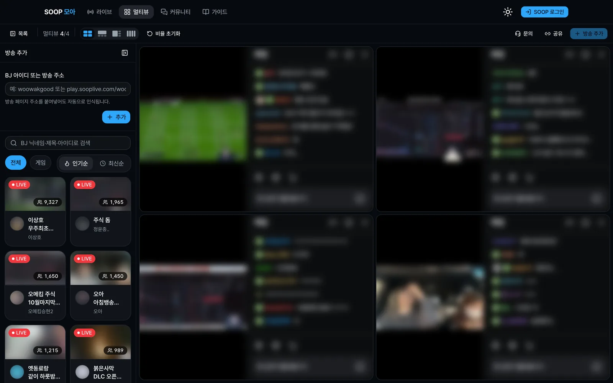

### 화면 배치

툴바의 배치 버튼이나 `L` 키로 모양을 바꿉니다. 메인 화면 하나를 크게 두고 나머지를 아래나 오른쪽에 모아 볼 수 있습니다.

작은 패널의 "메인 화면으로" 버튼이나 `M` 키를 누르면 그 방송이 큰 칸으로 올라갑니다. 자리만 바뀌고 방송은 끊기지 않습니다.

<table>
  <tr>
    <td>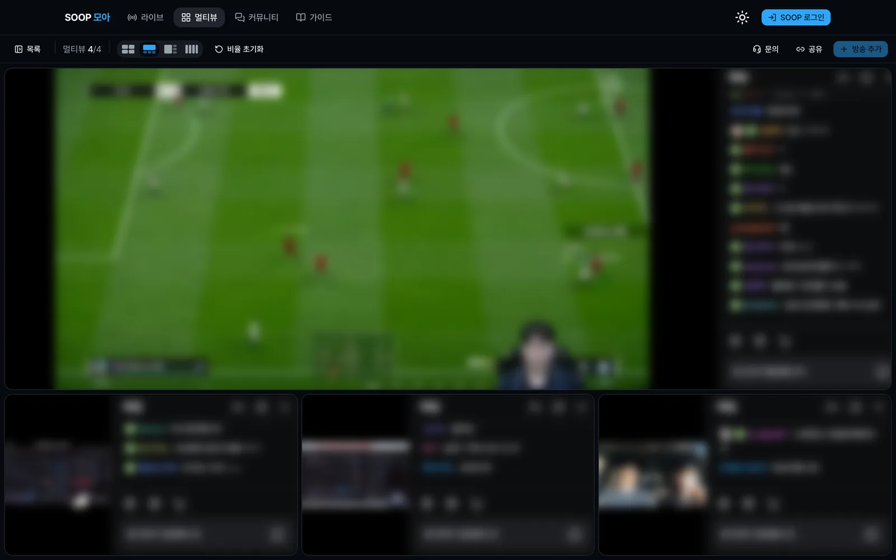</td>
    <td>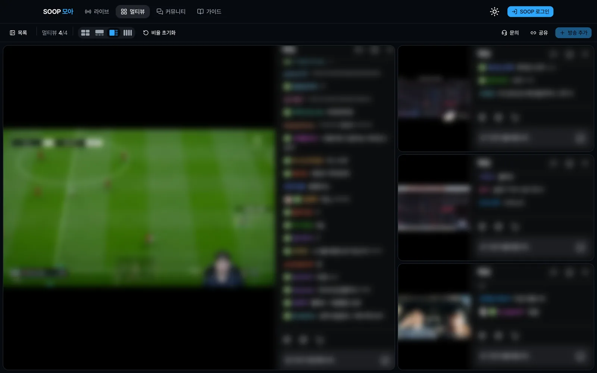</td>
    <td>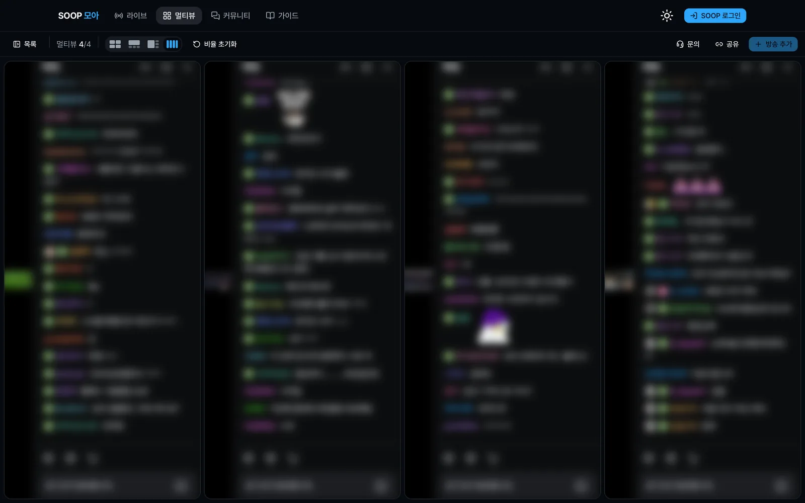</td>
  </tr>
  <tr>
    <td align="center">메인 위 · 아래 3</td>
    <td align="center">메인 왼쪽 · 오른쪽 3</td>
    <td align="center">가로 4열</td>
  </tr>
</table>

### 링크로 공유

툴바의 "공유"를 누르면 지금 보는 방송, 채팅 표시 여부, 화면 배치가 담긴 주소가 복사됩니다. 링크를 연 사람도 같은 구성을 그대로 봅니다.

구성은 브라우저에도 저장돼서 다음에 들어와도 이어서 볼 수 있습니다.

```
https://soopmoa.vercel.app/multiview?v=아이디1|아이디2|아이디3|아이디4&l=main-top
```

### 라이브 둘러보기

카테고리와 인기순·최신순으로 실시간 방송을 훑어보고, BJ 닉네임·제목·아이디로 검색합니다. 방송을 누르면 바로 멀티뷰에 담깁니다.

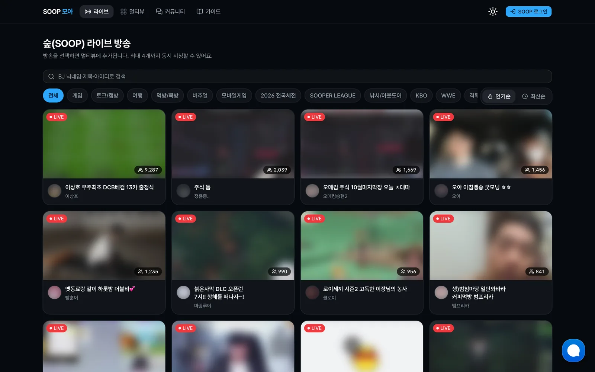

### 모바일

좁은 화면에서는 방송이 16:9 크기로 세로로 쌓이고, 스크롤하며 봅니다. PC에서 만든 공유 링크를 휴대폰에서 열어도 같은 구성이 복원됩니다.

<table>
  <tr>
    <td>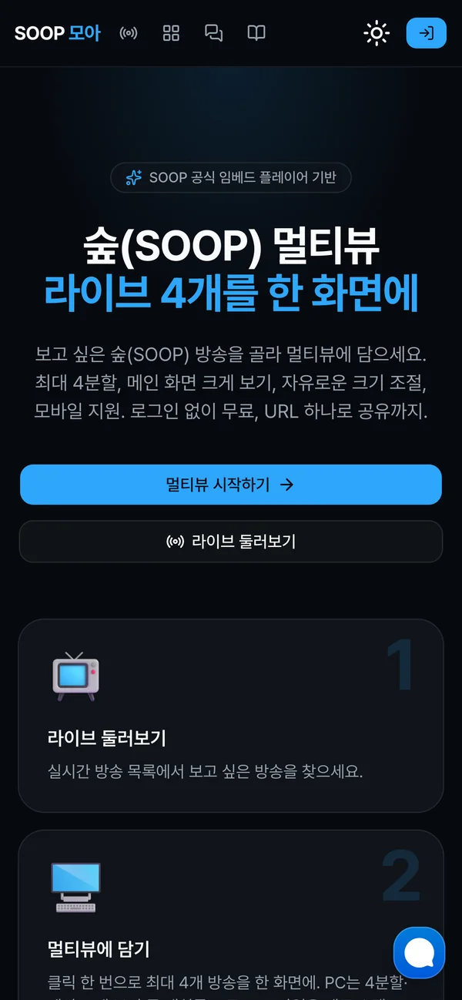</td>
    <td>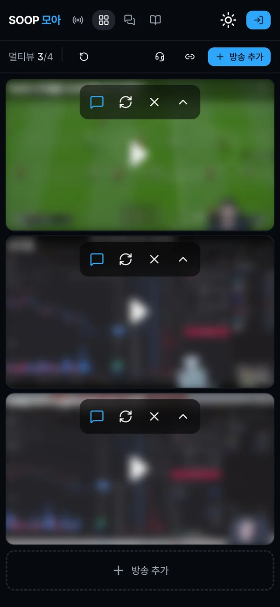</td>
    <td>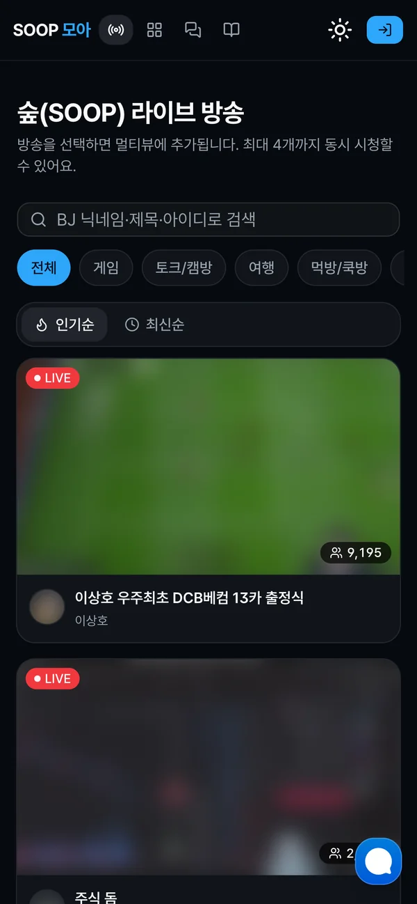</td>
  </tr>
  <tr>
    <td align="center">첫 화면</td>
    <td align="center">멀티뷰</td>
    <td align="center">라이브 목록</td>
  </tr>
</table>

### 사용 가이드

처음 쓰는 사람을 위해 PC·모바일 사용법, 키보드 단축키, 자주 묻는 질문을 한 페이지에 모았습니다.

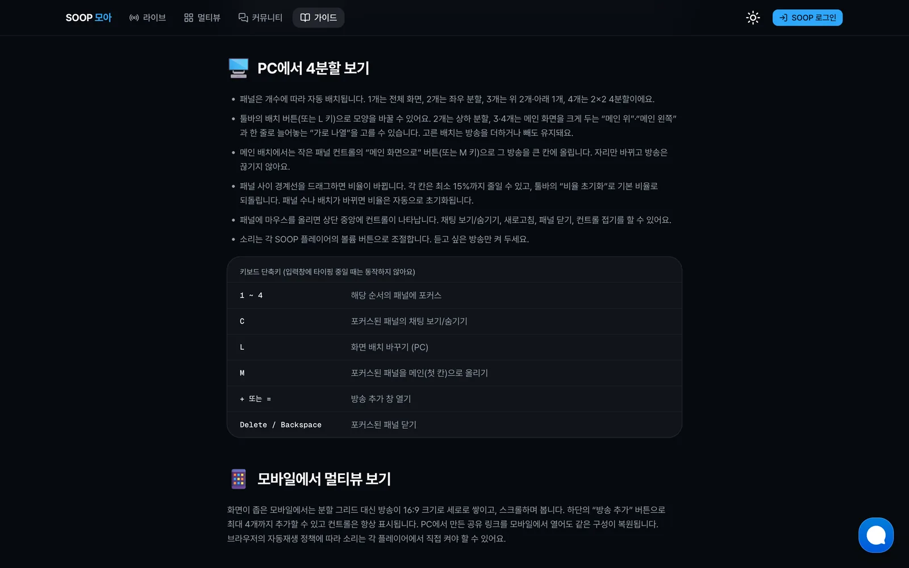

### 채팅 문의

사이트 오른쪽 아래 버튼으로 개발자에게 바로 문의할 수 있습니다. 멀티뷰 화면에서는 이 버튼이 방송 채팅창을 가리지 않도록 숨기고, 툴바의 "문의"로 엽니다.

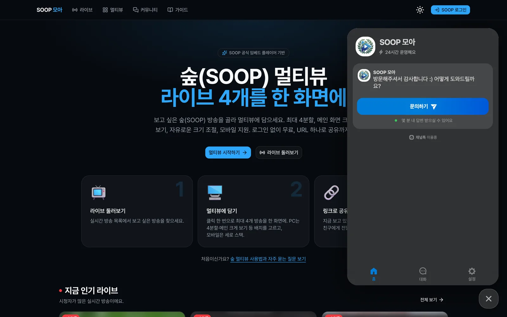

### 커뮤니티

SOOP 계정으로 로그인하면 글과 댓글, 답글을 남기고 좋아요·싫어요를 누를 수 있습니다. 글 읽기는 로그인 없이 됩니다.

내 글에 댓글이 달리거나 내 댓글에 답글이 달리면 헤더의 종 아이콘에 알림이 뜹니다. 알림을 누르면 그 댓글 위치로 바로 이동합니다.

## 기술 스택

Next.js 16 (App Router) · React 19 · TypeScript · Tailwind CSS v4 · shadcn/ui · SWR · TanStack Query · iron-session · Supabase

---

피드백과 문의사항은 사이트의 채팅 문의, 커뮤니티 또는 이메일(umseongjun@naver.com)로 언제든지 보내주세요. 감사합니다.
